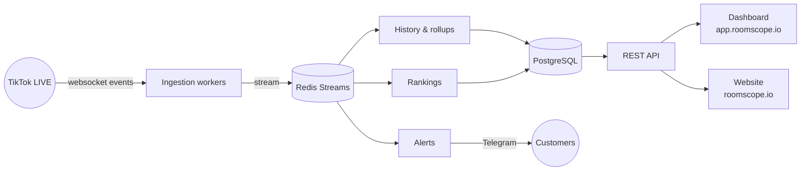

<div align="center">



<br/>

[](https://roomscope.io)
[](#-roadmap)
[](#-tech-stack)

**We watch thousands of TikTok LIVE rooms at once, so creators, agencies and brands don't have to.**

</div>

---

## 🔴 What is RoomScope?

RoomScope is a SaaS platform that turns TikTok LIVE into data you can act on. It tracks who is live, listens to each room in real time, and turns gifts, chat and viewer counts into alerts, rankings and reports.

<table>
<tr>
<td width="50%" valign="top">

### 📡 Live tracking
Knows which creators are live right now and connects to their rooms to capture every gift, comment and viewer change as it happens.

</td>
<td width="50%" valign="top">

### 🔔 Instant alerts
Rule-based notifications on Telegram the moment a creator goes live, a big gift lands or a watched gifter shows up.

</td>
</tr>
<tr>
<td width="50%" valign="top">

### 🏆 Rankings & leaderboards
Official boards by region, ranking history, and leaderboards for creators and top gifters.

</td>
<td width="50%" valign="top">

### 🧑‍🤝‍🧑 Agency tools
Host rosters, watchlists, live history and performance per creator, so agencies can manage and grow their talent.

</td>
</tr>
<tr>
<td width="50%" valign="top">

### 📊 Analytics & exports
Session history, gift and gifter rollups, best time to go live, CSV exports and outbound webhooks.

</td>
<td width="50%" valign="top">

### 🔑 Built for teams
Workspaces, member invites, API keys, usage-based credits and self-serve billing.

</td>
</tr>
</table>

## 🧭 How it works



## 📦 Repositories

| Repository | Role | Stack |
|---|---|---|
| 🧩 **[mkplatform](https://github.com/MKK-Platform/mkplatform)** | Parent repo: docs, roadmap, decisions, submodules | Git submodules |
| ⚙️ **[mkbackend](https://github.com/MKK-Platform/mkbackend)** | REST API and every background worker | Django · DRF · Celery · Redis · Postgres |
| 🖥️ **[mkdashboard](https://github.com/MKK-Platform/mkdashboard)** | Customer app and ops admin | Next.js 16 · React 19 · Tailwind 4 |
| 🌐 **[mkwebsite](https://github.com/MKK-Platform/mkwebsite)** | Marketing site, public showroom, CMS | Payload CMS 3 · Next.js 16 · shadcn/ui |
| 🚢 **[mkdevops](https://github.com/MKK-Platform/mkdevops)** | Compose stacks, proxy, deploy scripts, monitoring | Docker Compose · Traefik · just |

> [!NOTE]
> Most repositories are private. Ask an owner for access if you are joining the team.

## 🛠 Tech stack

<p>
  
  
  
  
  
  
  
  
  
  
  
  
  
  
</p>

## 🗺 Roadmap

| | Phase | Scope | Status |
|:-:|---|---|:-:|
| 🧱 | **Foundations** | Local stack, CI, app skeletons, branding | ✅ Done |
| 🔁 | **Phase A** | Rebuild the core product: accounts, workspaces, billing, ingestion, alerts, rankings, history, dashboard, website, ops admin | 🟢 Nearly done |
| 🚀 | **Phase B** | Gifter intelligence, extended alerts and rankings, creator analytics, host CRM, agency directory | 🟡 In progress |
| 🎉 | **Launch** | Production release as RoomScope | ⏳ Next |

## 🤝 How we work

```text
feature branch  ──PR──▶  develop  ──auto release──▶  main  ──▶  production
```

- One issue, one branch (`<type>/<N>-<slug>`), one squash-merged PR into `develop`.
- `main` is production and only moves through the release workflow.
- Port behaviour, not code: every rule from the old system ships with its tests.

## 📩 Contact:

- Email: `tuantq.itwork@gmail.com`
- Telegram: `@twain_tran`

---

<div align="center">

<sub>Made with ❤️ by the MKK Platform team · RoomScope is not affiliated with TikTok or ByteDance.</sub>

</div>
